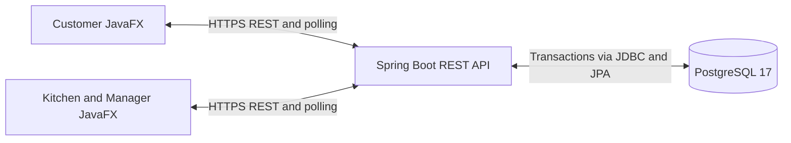

# Architecture

Both desktop applications connect to one backend. PostgreSQL owns the restaurant state. Clients never connect directly to the database.

## Code map

| Project | Where to start |
| --- | --- |
| Customer | `com.roseroots.customer.app` assembles the application. Navigation selects screens, `components` contains reusable JavaFX controls, `models` and `state` describe the client workflow, and `services.api` and `services.mock` supply connected and local implementations. Locale bundles, images and CSS live in Customer resources. |
| Kitchen and Manager | `com.roseroots.kitchen.app` assembles the workstation and manages personal sign-in and duty. `screens`, `components` and `model` render Kitchen state. `service.http` handles the authenticated Kitchen API. `com.roseroots.admin` contains the protected Manager workspace and Admin API client. |
| Server | `com.roseroots.server.ordering` handles Customer and Kitchen REST operations, identity scopes, visits, quotes, preparation, Assistance, settlement and feedback. `catalog` owns menu data and publication, `admin` contains Manager endpoints and security, and `settings` manages restaurant branding. Flyway SQL is under `server/src/main/resources/db/migration`. |

The desktop projects share JavaFX dependency configuration in `gradle/javafx-desktop.gradle`. Kitchen packages the Customer component stylesheet at `styles/components.css`. Server packages the Customer rose mark at `branding/rose-mark.png`. These are build-time resource copies and introduce no runtime dependency on the Customer app.

## Requests and state changes

- **Identity.** A provisioned Customer terminal uses a revocable bearer credential scoped to its restaurant and terminal. Visits and receipts are scoped server-side. A shared Kitchen workstation has restricted board access. Personal staff sessions authorize role-specific mutations. Manager uses the existing protected session and CSRF checks.
- **Order.** The server validates availability, selected options and allergens, calculates a price quote and accepts the order transactionally with price and preparation snapshots. Submission retries are idempotent. Eligible accepted-item amendments use versions and preserve history and unaffected snapshots.
- **Prepare and serve.** A qualified on-duty Chef claims items and advances RECEIVED → PREPARING → READY. Allergy review and station restrictions are enforced server-side. The Waiter explicitly records SERVED or COLLECTED. Supervisors manage audited priority changes and reassignment.
- **Settle.** A visit can include multiple order rounds. The bill and its version govern cash attempts. Verified staff confirmation produces an immutable receipt. Recovery is visit-scoped or authorized for one receipt by a Manager.
- **Review.** Actual handoff establishes eligibility. Dish, order and restaurant feedback are persisted independently under their applicable rules. Kitchen sees relevant food feedback and Managers see authorized reporting and follow-up.

Clients refresh authoritative state through HTTPS REST polling. Screens reconcile versions on refresh and reconnect after a transient failure. PostgreSQL supplies durable state across restarts. Flyway applies versioned migrations on startup through V26. Add schema changes as reviewed migrations and rehearse upgrades with restored or disposable data.

Read the [documentation index](README.md) for wire contracts, focused workflow guides and historical decisions.

## Maintenance notes for reviewers

The former root Customer project made the repository name misleading and hid a real module boundary. The move preserves Java packages, JPMS module names, Customer distribution names and the resources inside each JAR. The Customer test task still reads the shared OpenAPI fixture from the repository root and tracks it as an input. The catalog importer now defaults to the integrated Customer project, with an explicit override for a separate source tree.

Several classes warrant close review as their workflows grow. `OrderingService` coordinates transactional visit, order and item state. `SpringBootKitchenService` combines request transport, reconciliation and staff session state. `CartScreen` and `OrdersScreen` coordinate asynchronous JavaFX state and rendering. `CatalogWorkspace` composes related catalog operations. Their names identify the owning domains, and moving or splitting them is outside this layout change. Keep contract changes and business logic refactors in dedicated pull requests.
